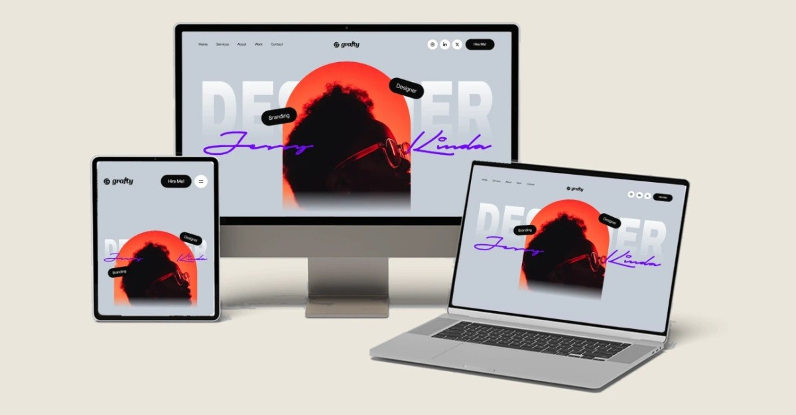
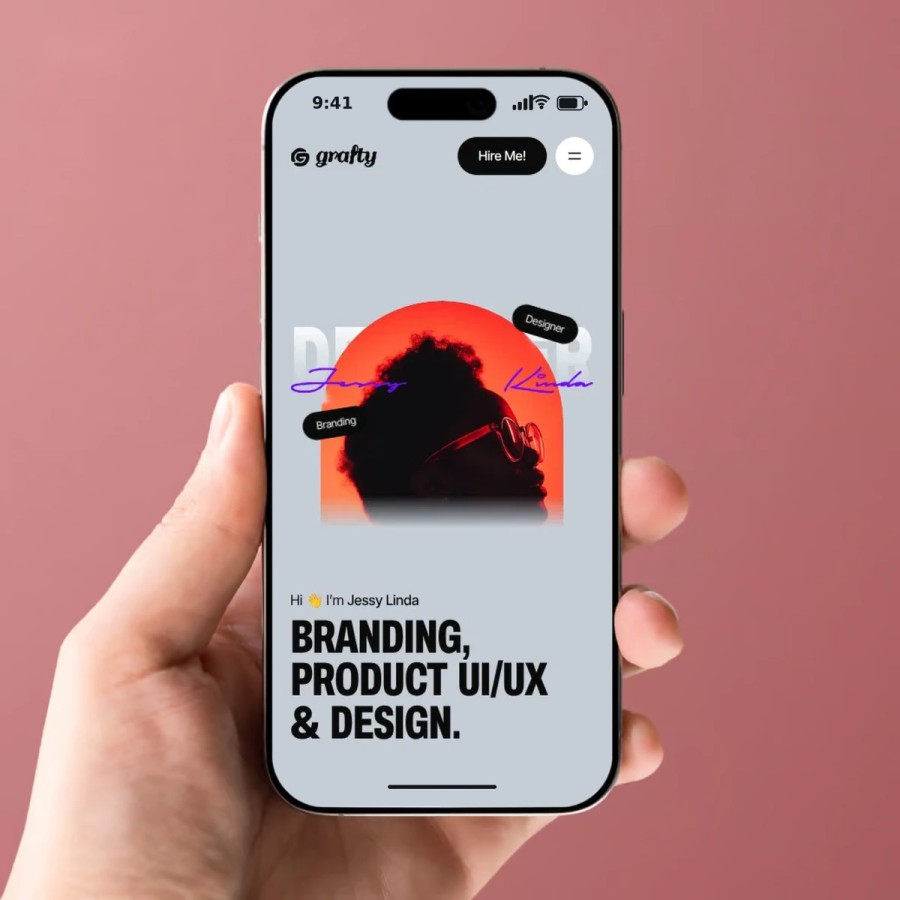
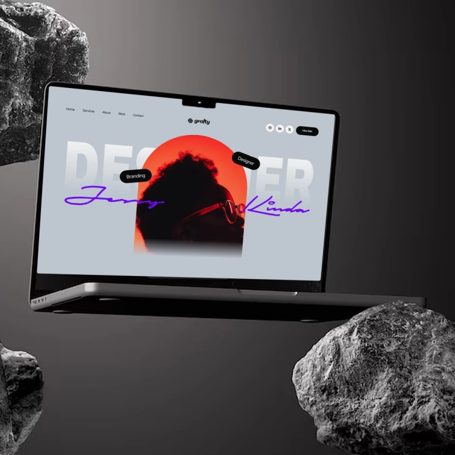
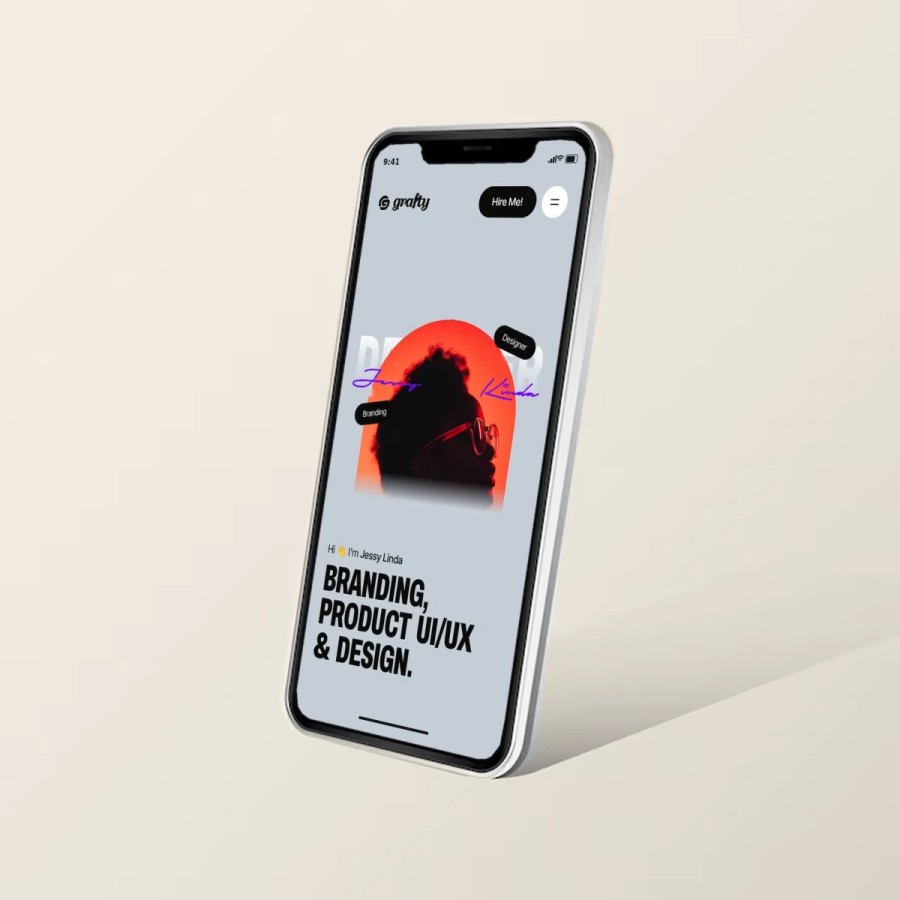

# Grafty: Next.js Portfolio Website (Figma to Code)

A responsive **Next.js portfolio website** built from a Figma mockup, with smooth scroll animations, case study pages, a project brief form and call booking. Written in TypeScript with Tailwind CSS and Framer Motion.

[](https://grafty-portfolio.vercel.app/)




## Features

- **Figma to Next.js:** on desktop every size scales with the page width, like the design. Tablet and phone have their own layouts.
- **Scroll animations:** project cards pin and stack, a reading-progress line fills as you scroll, text lights up word by word, and the navbar hides on the way down.
- **First-visit loader:** a short counter and curtain that plays once and is skipped for reduced motion.
- **Pages:** Home, About, Services, Work (with filters and case studies), Contact, Privacy, Terms, a printable CV and custom 404 and error screens.
- **Contact:** a project brief form (one step at a time on phones) and a call booking calendar.
- **Accessible:** keyboard-friendly menus and dialogs, a skip link, reduced-motion support and colour contrast checked against WCAG AA.
- **SEO ready:** metadata, Open Graph share image, sitemap, robots file, structured data and a web manifest.
- **Privacy-friendly analytics:** Vercel Web Analytics, no cookies.

<p align="center">
  
  
  
</p>

## Tech stack

| | |
| --- | --- |
| Framework | Next.js 16 (App Router), React 19 |
| Language | TypeScript |
| Styling | Tailwind CSS v4 |
| Animation | Framer Motion, Lenis (smooth scrolling) |
| Email (optional) | Resend |
| Hosting | Vercel |

## Getting started

```bash
git clone https://github.com/AbidHussainOFFICIAL/Grafty-portfolio.git
cd Grafty-portfolio
npm install
npm run dev        # http://localhost:3000
```

Needs Node.js 20.9 or newer. For a production build run `npm run build && npm start`. Other scripts: `npm run typecheck` and `npm run lint`.

Sending email is off by default, so the contact forms run in demo mode. To switch it on, copy `.env.example` to `.env.local` and add your Resend details.

## Project structure

```
src/
  app/          pages, metadata, share image, icons, 404 and error screens
  components/   sections, ui, layout, about, services, work, case, contact, legal, cv, status, seo
  data/         content.ts (all text, links and projects), legal text, artwork, blur previews
  lib/          hooks and helpers (validation, booking, analytics)
public/         images, app icons and the CV PDF
docs/           the full guide and the README images
```

All text, links and projects live in `src/data/content.ts`, so content changes never touch the components. The full guide (where to change things and a publishing checklist) is in [docs/GUIDE.md](docs/GUIDE.md).

## Assets

The names, photos, logos, prices and case studies in the site are placeholder demo content and are not covered by the license. The code is released under the [MIT License](LICENSE).

## Author

Built by **Abid Hussain**, a full-stack developer based in Karachi, Pakistan.
[LinkedIn](https://www.linkedin.com/in/abidhussainsoftware/) · [GitHub](https://github.com/AbidHussainOFFICIAL)
